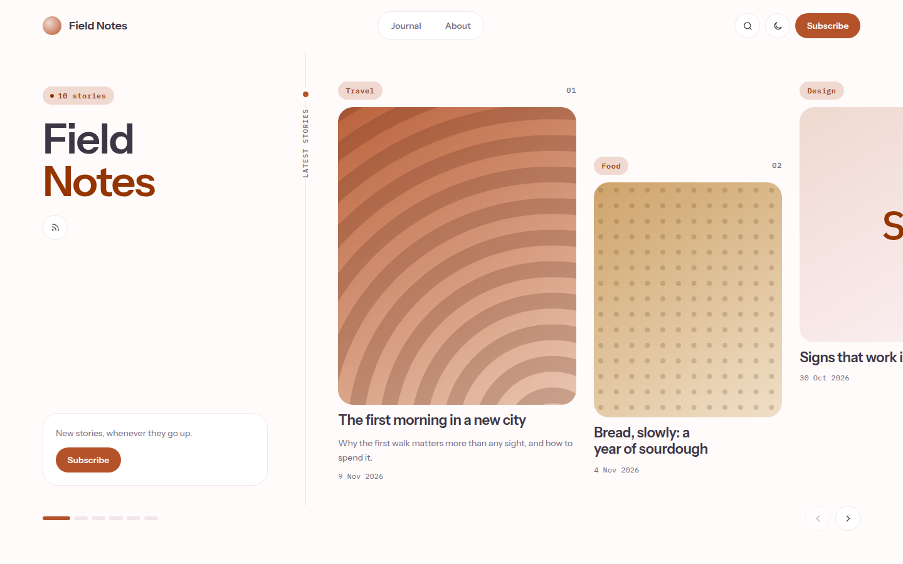

# Hanagasumi

Soft pastel blog theme: a split homepage with a sideways-scrolling story rail, rounded cards, pill chips and mono labels in rose on warm mist.



A theme for [Hatamoto](https://hatamoto.dev), built for blog sites.

## Install

From the registry: **Theme > Themes > Available themes**, then **Install**, **Preview**
and **Activate**. From a terminal on the server:

```sh
hatamoto package install hanagasumi-<version>.hmp
hatamoto theme activate hanagasumi
```

Layouts and sections the theme does not ship come from the built-in theme, so every
page keeps rendering.

## What it ships

- A partial theme: the shell (header, footer), home, single post, archive and category/tag listing, search and 404. Everything else (pages, authors) comes from the built-in theme.
- A split homepage: intro and newsletter card beside a sideways-scrolling story rail, then a journal list and a newsletter panel.
- Rounded cards, pill chips and mono labels in rose on warm mist. Light and dark.
- A pill header with a menu sheet on small screens that works without JavaScript. JavaScript only adds the rail buttons, the contents highlight, copy link and the colour toggle.

## Settings

**Theme > Themes > Hanagasumi > Settings**. Every setting has a default.

| Key | Type | Default | What it does |
| --- | --- | --- | --- |
| `color_mode` | `light`, `dark`, `auto` | `auto` | What a first visit shows; `auto` follows the system. Visitors can still switch with the header toggle. |
| `density` | `comfortable`, `compact` | `comfortable` | Spacing between sections. |
| `story_rail` | on/off | on | The sideways-scrolling story rail on the home page. Off shows the intro and a plain journal list. |
| `corner_style` | `soft`, `round` | `round` | Corner radius of cards, fields and images. |
| `show_newsletter` | on/off | on | The intro card, the home panel and the footer field. |
| `archive_url` | text | `/blog` | Address of the post archive, for the "All" chip, "All stories" and the back link on posts. |
| `post_toc` | on/off | on | The "On this page" list on posts. |

## Colours and fonts

**Theme > Colours** drives the accent; the text and soft tints of the accent are derived from it with `color-mix`, so any primary colour keeps readable contrast.

[Instrument Sans](https://fonts.google.com/specimen/Instrument+Sans) and [IBM Plex Mono](https://fonts.google.com/specimen/IBM+Plex+Mono), both under the SIL Open Font License 1.1, self-hosted in `assets/fonts/` with their licences.

## Develop

From the root of the `hatamoto-themes` repository:

```sh
scripts/dev-site.sh blog themes/hanagasumi --serve   # a seeded local site with this theme
scripts/check.sh themes/hanagasumi                   # the full check
```

`dev/` is not part of the package.

## License

Apache-2.0, see [LICENSE](LICENSE).
