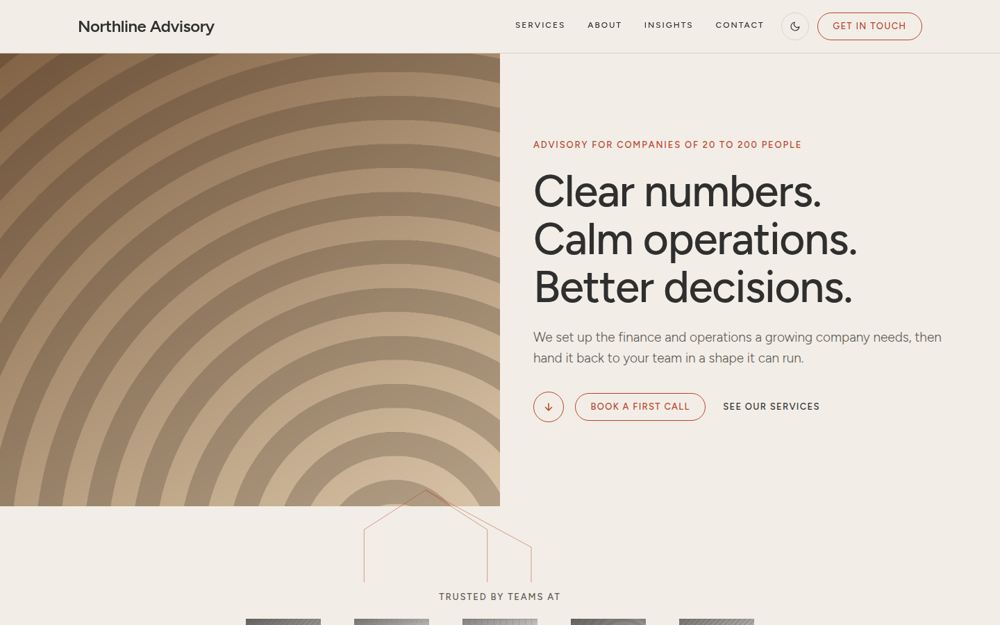

# Hearth

Warm, photo-led theme for home builders and trades: split heroes, full-bleed photo bands, a step-by-step process list and a terracotta footer.



A theme for [Hatamoto](https://hatamoto.dev), built for business sites. On other site types it keeps rendering, with the same header, footer and type.

## Install

From the registry: **Theme > Themes > Available themes**, then **Install**, **Preview**
and **Activate**. From a terminal on the server:

```sh
hatamoto package install hearth-<version>.hmp
hatamoto theme activate hearth
```

Layouts and sections the theme does not ship come from the built-in theme, so every
page keeps rendering.

## Settings

**Theme > Themes > Hearth > Settings**:

| Setting | Default | What it does |
| --- | --- | --- |
| Colour mode | `auto` | what a first visit shows: `light`, `dark` or `auto` (follows the system); visitors can still switch |
| Spacing | `comfortable` | `compact` tightens the space between sections |
| Header button label | `Get in touch` | the outlined button in the header; empty hides it |
| Header button address | `/contact` | where the header and footer buttons lead |
| Footer headline | `Every project starts with a conversation.` | the large line in the terracotta footer band |
| Footer text | `Tell us about your block and what you want to build.` | the line under the headline |
| Footer grain | on | a fine film grain over the footer band |
| House outline on the hero | on | a thin house outline across the split hero on wide screens |
| Footer email | empty | an email address next to the phone number in the footer |

Colours, fonts and corners follow **Theme > Colours and fonts**.

## Develop

From the root of the `hatamoto-themes` repository:

```sh
scripts/dev-site.sh business themes/hearth --serve   # a seeded local site with this theme, live reload
scripts/check.sh themes/hearth                            # the full check: package, render, browser, screenshot
```

`dev/` is not part of the package.

## License

Apache-2.0, see [LICENSE](LICENSE).
