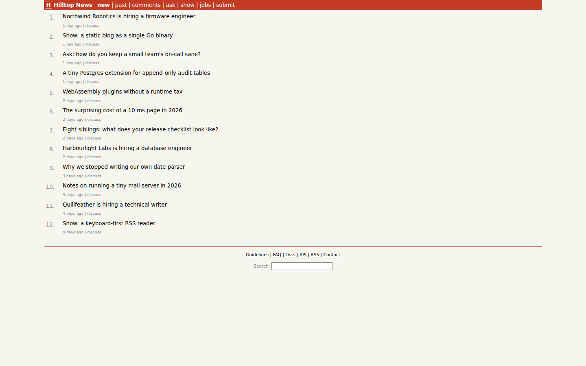

# HN Classic

A link-and-discussion theme: a coloured header bar, ranked story rows, threaded comments with no-JS vote and flag forms, Verdana, no JavaScript.



A theme for Hatamoto, built for link-and-discussion sites.

## Install

From the registry: **Theme > Themes > Available themes**, then **Install**, **Preview**
and **Activate**. From a terminal on the server:

```sh
hatamoto package install hn-classic-<version>.hmp
hatamoto theme activate hn-classic
```

Layouts and sections the theme does not ship come from the built-in theme, so every
page keeps rendering.

## Settings

**Theme > Themes > HN Classic > Settings**:

| Setting | Default | What it does |
| --- | --- | --- |
| Page width | `wide` | `wide` is the centred 85% column, `full` uses the whole window (always full width under 750 px) |
| Comment vote and flag buttons | on | prints the no-JavaScript vote and flag forms on comments, posting to `/p/hn/...`; turn off on a site without the hn plugin |

Colours, fonts and corners follow **Theme > Colours and fonts** (the header bar uses the
primary colour).

## Story pages

`layouts/single-hn-story.html` and `layouts/archive-hn-story.html` render the `hn-story` schema
(`url_pattern` `/item/{slug}`) with the attributes `url` (the story link), `text` (plain text,
shown under the title; the entity body is the fallback) and `kind` (`story`, `ask`, `show`,
`job`; a `job` row has no author). Other schemas use the built-in layouts.

## Markup the hn plugin prints

The theme styles, but does not print, the markup of the hn plugin. Its section types are
`hn_feed`, `hn_submit`, `hn_item`, `hn_login`, `hn_user`, `hn_userbar` and `hn_threads`. The class vocabulary:

- Story list (`hn_feed`, and the head of `hn_item`): `ol.hn-stories > li.hn-story`, each row a grid of
  `.hn-rank`, `.hn-vote-cell` and `.hn-title` (with `.hn-site` for the host), then `.hn-sub`
  (`.hn-score`, `a.hn-user`, the age, `.hn-act` forms holding `.hn-unvote`, `.hn-edit` or `.hn-delete`
  buttons or links). The vote cell holds `form.hn-vote-form > button.hn-vote` (drawn as the grey arrow),
  an empty `span.hn-vote` or, once voted, `span.hn-vote.hn-voted` (arrow hidden). `.hn-more` is the
  "More" link, `.hn-heading` a line above the list, `.hn-notice` a status line and `.hn-note` a grey note.
- Item page (`hn_item`): `.hn-item-head > .hn-story`, then `.hn-item-text` with one `<p>` per paragraph.
- Submit (`hn_submit`): `table.hn-form-tbl` with `.hn-lbl` label cells, then a `.hn-note`.
- Login (`hn_login`): `div.hn-login` with a bold line, a form or link and a `.hn-note`.
- User page (`hn_user`): `div.hn-user` holding a plain two-column `<th>`/`<td>` table; the owner's
  page is a form with inputs.
- Threads and newest comments (`hn_threads`): `div.hn-threads` with an optional `h2`, a `.hn-notice`, one
  `div.hn-c` per comment (`.hn-dead` and `.hn-faint` states) holding a `.hn-head` line, a `.hn-text` body
  and a `.hn-reply` link, then a `.hn-more` link. The vote cell in the head line is `span.hn-vote` with
  `form.hn-vote-form` buttons (up and down arrows, or an `unvote` text button). The theme gives these the
  look of its own comment rows.
- User bar (`hn_userbar`): on the pages the plugin serves, it injects `div.hn-ub` as the first section
  of `main`, straight under the header bar, not in the header. The theme zeroes the padding and rule
  core puts on every plugin wrapper (`section.hm-section` whose class starts `hm-section--hn_`). The theme gives it the bar colour
  and right-aligns it. The `.hn-userbar` span inside the header stays an empty slot.
- Comments: `li.hn-c` with `.hn-c-row`, `.hn-vote`, `.hn-head`, `.hn-op`, `.hn-text` and `.hn-reply`;
  states `.hn-dead`, `.hn-faint` and `.hn-collapsed` go on the `li.hn-c`.
- Arrow sprite, available on every page: `<svg><use href="#hn-up"/></svg>` and `#hn-down`.

The comment rows the theme prints itself carry two forms for the plugin:

- `POST /p/hn/vote/comment/<id>` with hidden `how=up` and `next`
- `POST /p/hn/flag/comment/<id>` with hidden `next`

The vote cell on each comment row is `<span class="hn-vote" data-hn-comment="<id>">`, printed whether
or not the forms are, so the plugin script can mark the arrows the visitor already used.

`<id>` is the comment id, the same as the row's `id="comment-<id>"`. Neither form is printed for
the visitor's own comment.

## Known gaps

- The grey sub line (`#828282` on `#f6f6ef`) is about 3.4:1, below WCAG AA for small text. It is
  kept from the approved design; links underline on hover and focus and nothing relies on colour
  alone. A later version may darken it.
- Dead, faint and collapsed comments, a vouch form and a sign-in page are styled but need fields
  core does not expose yet (comment status, a sign-in layout, a locked name field). Follow-ups.
- Story rank restarts at 1 on archive pages after the first.
- No dark mode, by design.

## Develop

From the root of the `hatamoto-themes` repository:

```sh
scripts/dev-site.sh blog themes/hn-classic --serve   # a seeded local site with this theme, live reload
scripts/check.sh themes/hn-classic                   # the full check: package, render, browser, screenshot
```

`dev/` is not part of the package.

## License

Apache-2.0, see [LICENSE](LICENSE).
