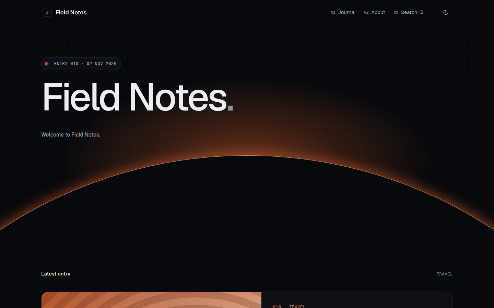

# Kaizen

A dark-first blog theme: a glowing horizon hero, a numbered index with sticky months, smooth page transitions and a live status strip in the footer.



A theme for [Hatamoto](https://hatamoto.dev), built for blog sites.

## Install

From the registry: **Theme > Themes > Available themes**, then **Install**, **Preview**
and **Activate**. From a terminal on the server:

```sh
hatamoto package install kaizen-<version>.hmp
hatamoto theme activate kaizen
```

Layouts and sections the theme does not ship come from the built-in theme, so every
page keeps rendering.

## Settings

**Theme > Themes > Kaizen > Settings**:

| Setting | Default | What it does |
| --- | --- | --- |
| Colour mode | `dark` | what a first visit shows: `dark`, `light` or `auto` (follows the system); visitors can still switch with the toggle in the header or footer |
| Show the latest entry card | on | the large card above the index on the first page of the home page |
| Show the footer status strip | on | the strip with status, local time, viewport and entry count |
| Show the large footer wordmark | on | the outlined site name at the bottom of the footer |

Colours, fonts and corners follow **Theme > Colours and fonts**.

In dark mode (the default) the Background and Text colours from that page do not apply: the theme keeps its own palette so text stays readable. Primary colour, fonts and corners apply in both modes; Background and Text apply in light mode.

## Develop

From the root of the `hatamoto-themes` repository:

```sh
scripts/dev-site.sh blog themes/kaizen --serve   # a seeded local site with this theme, live reload
scripts/check.sh themes/kaizen --screenshot      # the full check, and writes assets/screenshot.png
```

`dev/` is not part of the package.

## Fonts

Geist and Geist Mono, self-hosted, SIL Open Font License 1.1 (licence texts in
`assets/fonts/`). Nothing is loaded from another host.

## License

Apache-2.0, see [LICENSE](LICENSE).
