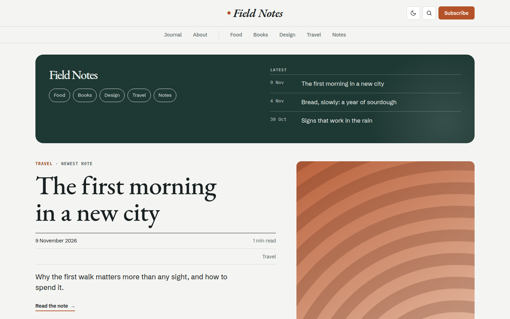

# Kazahana

Editorial blog theme with a masthead and topic strip, big EB Garamond headlines, hairline meta rows and a pine intro block, in snow white and camellia red.



A theme for [Hatamoto](https://hatamoto.dev), built for blog sites.

## Install

From the registry: **Theme > Themes > Available themes**, then **Install**, **Preview**
and **Activate**. From a terminal on the server:

```sh
hatamoto package install kazahana-<version>.hmp
hatamoto theme activate kazahana
```

Layouts and sections the theme does not ship come from the built-in theme, so every
page keeps rendering.

## Settings

**Theme > Themes > Kazahana > Settings**:

| Setting | Default | What it does |
| --- | --- | --- |
| Colour mode | `light` | what a first visit shows: `light`, `dark` or `auto` (follows the system); visitors can still switch |
| Spacing | `comfortable` | `compact` tightens the space between sections |

Colours, fonts and corners follow **Theme > Colours and fonts**.

## Develop

From the root of the `hatamoto-themes` repository:

```sh
scripts/dev-site.sh blog themes/kazahana --serve   # a seeded local site with this theme, live reload
scripts/check.sh themes/kazahana                            # the full check: package, render, browser, screenshot
```

`dev/` is not part of the package.

## License

Apache-2.0, see [LICENSE](LICENSE).
