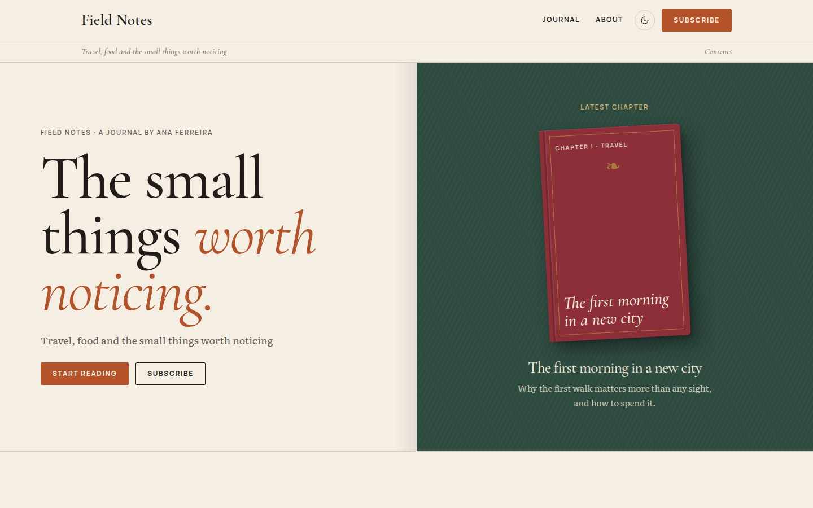

# Kimyou

Literary blog theme for writers: linen paper, oxblood and book-cloth green, posts as chapters, categories as spines on a shelf.



A theme for [Hatamoto](https://hatamoto.dev), built for blog sites.

## Install

From the registry: **Theme > Themes > Available themes**, then **Install**, **Preview**
and **Activate**. From a terminal on the server:

```sh
hatamoto package install kimyou-<version>.hmp
hatamoto theme activate kimyou
```

Layouts and sections the theme does not ship come from the built-in theme, so every
page keeps rendering.

## What it ships

- Home, single post, about page, archive, category and tag, author, search and 404 layouts.
- A header with the menu, a colour toggle and a button, and a running head with the site tagline and the section; the menu works without JavaScript on small screens.
- A cover with a two-tone headline beside the latest post as a book, a numbered contents list, a shelf where every category is a spine, a books section, a pull quote and a journal grid, all filled from your content and hidden when there is nothing to show.
- Posts as chapters: a drop cap, section signs, an avatar byline, an author box and previous and next chapter links.
- Light and dark. No JavaScript is needed for anything except the colour toggle.

## Settings

**Theme > Themes > Kimyou > Settings**. Every setting has a default.

| Setting | Type | Default | What it does |
| --- | --- | --- | --- |
| Colour mode (`color_mode`) | `light`, `dark`, `auto` | `auto` | What a first visit shows; `auto` follows the system. Visitors can still switch with the header toggle. |
| Spacing (`density`) | `comfortable`, `compact` | `comfortable` | `compact` tightens the space between sections. |
| Home headline (`home_headline`) | text | `The small things \| worth noticing.` | The cover headline. Text after `\|` is set in italic in the primary colour. Empty uses the default. |
| Home lede (`home_lede`) | text | empty | The line under the headline. Empty uses the site tagline. |
| Show the shelf (`show_shelf`) | on/off | on | The shelf of categories on the home page. |
| Books category (`books_category`) | category slug | `books` | The category shown in "On books". Empty, or a slug that does not exist, hides the section. |
| Ornaments (`ornaments`) | `full`, `quiet` | `full` | `quiet` drops the drop cap, section signs, fleurons, roman numerals and "Chapter" labels, and sets titles upright. |

Colours, fonts and corners follow **Theme > Colours and fonts**. The paper, shelf and cloth tones are the theme's own, set for contrast on the default palette.

## Fonts

[Cormorant Garamond](https://fonts.google.com/specimen/Cormorant+Garamond) (headings),
[Literata](https://fonts.google.com/specimen/Literata) (text) and
[Manrope](https://fonts.google.com/specimen/Manrope) (labels), all under the SIL Open Font
License 1.1, bundled in `assets/fonts/` with their licences.

## Develop

From the root of the `hatamoto-themes` repository:

```sh
scripts/dev-site.sh blog themes/kimyou --serve   # a seeded local site with this theme, live reload
scripts/check.sh themes/kimyou --screenshot       # the full check, and the registry preview
```

`dev/` is not part of the package.

## License

Apache-2.0, see [LICENSE](LICENSE).
