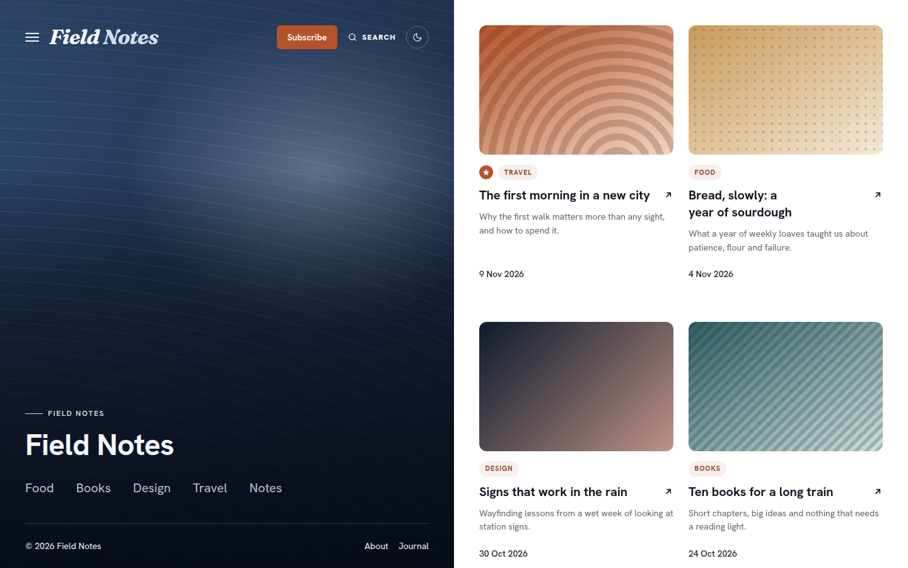

# Kogarashi

Split-screen blog theme. A fixed midnight image panel on one side, a scrolling grid of post cards on the other, cobalt accents.



A theme for [Hatamoto](https://hatamoto.dev), built for blog sites.

## Install

From the registry: **Theme > Themes > Available themes**, then **Install**, **Preview**
and **Activate**. From a terminal on the server:

```sh
hatamoto package install kogarashi-<version>.hmp
hatamoto theme activate kogarashi
```

Layouts and sections the theme does not ship come from the built-in theme, so every
page keeps rendering.

## Settings

**Theme > Themes > Kogarashi > Settings**:

| Key | Type | Default | Effect |
| --- | --- | --- | --- |
| `color_mode` | `light`, `dark`, `auto` | `auto` | What a first visit shows; `auto` follows the system. Visitors can still switch with the header toggle. |
| `panel_image` | image | empty | Photo behind the side panel, tinted so the text stays readable. Empty uses the midnight gradient. |
| `panel_side` | `left`, `right` | `left` | Side of the screen the fixed panel sits on (desktop). Below 900 px the panel is always on top. |
| `grid_columns` | `2`, `3` | `2` | Post card columns on the home page; `3` applies on screens 1400 px wide and up. |
| `show_excerpts` | on/off | on | Short excerpt under each post title on cards and list rows. |
| `density` | `comfortable`, `compact` | `comfortable` | `compact` tightens the space between builder sections. |

Colours, fonts and corners follow **Theme > Colours and fonts**. The accent is the
Primary colour. In dark mode the theme uses its own derived palette, so the owner
Background and Text colours do not apply there.

## Fonts

Hanken Grotesk and Fraunces (italic, for the wordmark), both SIL Open Font Licence 1.1,
self-hosted with their licences in `assets/fonts/`.

## Develop

From the root of the `hatamoto-themes` repository:

```sh
scripts/dev-site.sh blog themes/kogarashi --serve   # a seeded local site with this theme, live reload
scripts/check.sh themes/kogarashi                    # the full check: package, render, browser, screenshot
```

`dev/` is not part of the package.

## License

Apache-2.0, see [LICENSE](LICENSE).
