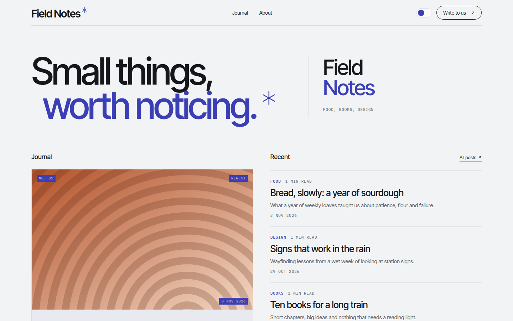

# Komorebi

Quiet, typographic blog theme: a two-tone split hero, a featured card with generated pixel art, hairline post lists and mono labels, in indigo and peach.

Komorebi is the light that filters through leaves. Paper-white pages, thin rules, one strong colour. Light and dark.



A theme for [Hatamoto](https://hatamoto.dev), built for blog sites.

## Install

From the registry: **Theme > Themes > Available themes**, then **Install**, **Preview**
and **Activate**. From a terminal on the server:

```sh
hatamoto package install komorebi-<version>.hmp
hatamoto theme activate komorebi
```

Layouts and sections the theme does not ship come from the built-in theme, so every
page keeps rendering.

## What it ships

- Home, single post, plain page, archive, category and tag, author, search and 404 layouts.
- A header with the menu, a colour toggle and an outlined button; a menu that works without JavaScript on small screens.
- A split hero with a two-tone headline, a featured card beside the latest posts, a grid of your three biggest topics and an about band, all filled from your content and hidden when there is nothing to show.
- Generated pattern art (pixels, arcs, stripes, bars, dots) for posts and topics without a featured image. It is decorative, drawn inline and picked the same way for the same post on every page.
- A footer with a large closing line, back-to-top button, your footer menu, social links and feeds.
- Light and dark. No JavaScript is needed for anything except the colour toggle.

## Settings

**Theme > Themes > Komorebi > Settings**. Every setting has a default.

| Setting | Type | Default | What it does |
| --- | --- | --- | --- |
| Colour mode (`color_mode`) | `light`, `dark`, `auto` | `auto` | What a first visit shows; `auto` follows the system. Visitors can still switch with the header toggle. |
| Spacing (`density`) | `comfortable`, `compact` | `comfortable` | `compact` tightens the space between sections. |
| Hero line 1 (`hero_line_1`) | text | `Small things,` | First headline line. When both lines are empty the site name is split in two. |
| Hero line 2 (`hero_line_2`) | text | `worth noticing.` | Second line, in the primary colour. |
| Header button label (`header_cta_label`) | text | `Write to us` | The outlined header button and the large line in the footer. The site's own header button (Site settings) wins when set. |
| Header button address (`header_cta_url`) | URL | `/about` | Where both lead; empty hides the button and the footer line. The about band on the home page reads the page at this address. |
| Address of the post archive (`archive_url`) | URL | `/blog` | Where the "All posts" links and the "All" category chip lead. |
| Home page sections (`home_sections`) | on/off | off | Prints the blocks of the home page built in the editor below the about band. |
| About statement (`about_statement`) | text | empty | The large line in the home page about band. Empty uses "About" and the site name. |
| Show topics (`show_topics`) | on/off | on | The three categories with the most posts on the home page. |
| Generated art (`generated_art`) | on/off | on | Pattern art for posts and topics without an image. Off gives text-only cards. |

## Colours and fonts

**Theme > Colours and fonts** restyles the primary colour, background, text, fonts and
corners. The paper, panel, rule and muted tones are the theme's own, set for contrast on
the default palette. The home page uses your site tagline for the hero lead; add one in **Settings** for the full effect.

## Fonts

[Inter Tight](https://fonts.google.com/specimen/Inter+Tight) (headings and text) and
[IBM Plex Mono](https://fonts.google.com/specimen/IBM+Plex+Mono) (labels and dates), both
under the SIL Open Font License 1.1, bundled in `assets/fonts/` with their licences.

## Develop

From the root of the `hatamoto-themes` repository:

```sh
scripts/dev-site.sh blog themes/komorebi --serve   # a seeded local site with this theme, live reload
scripts/check.sh themes/komorebi --screenshot      # the full check, and the registry preview
```

`dev/` is not part of the package.

## License

Apache-2.0, see [LICENSE](LICENSE).
