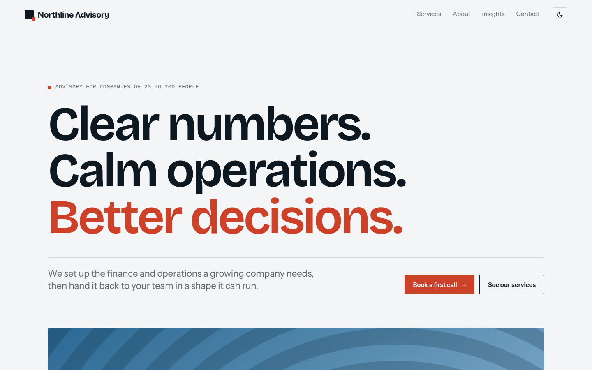

# Murasaki

Studio theme for agencies and advisory firms. Oversized type, hairline index rows, numbered sections and one vermilion accent.



A theme for [Hatamoto](https://hatamoto.dev), built for business sites.

## Install

From the registry: **Theme > Themes > Available themes**, then **Install**, **Preview**
and **Activate**. From a terminal on the server:

```sh
hatamoto package install murasaki-<version>.hmp
hatamoto theme activate murasaki
```

Layouts and sections the theme does not ship come from the built-in theme, so every
page keeps rendering.

## Settings

**Theme > Themes > Murasaki > Settings**:

| Setting | Type | Default | What it does |
| --- | --- | --- | --- |
| Colour mode (`color_mode`) | `light`, `dark`, `auto` | `auto` | what a first visit shows; `auto` follows the visitor's system; the header toggle still switches and is remembered |
| Spacing (`density`) | `comfortable`, `compact` | `comfortable` | `compact` tightens the space between sections |
| Footer wordmark (`footer_wordmark`) | on/off | on | the site name as a giant wordmark in the footer |
| Section numbers (`section_numbers`) | on/off | on | prefixes section eyebrows with `01 /`, `02 /` and so on |
| Header button label (`header_cta_label`) | text | empty | shows a button in the header; empty means none; a button set in the site menu always wins |
| Header button address (`header_cta_url`) | text | `/contact` | where the header button goes |
| Hero accent (`hero_accent`) | on/off | on | the last sentence of the home headline in the accent colour |

## Colours and fonts

**Theme > Colours and fonts** restyles the theme: Primary is the accent (the theme
darkens it slightly for fills and small text so text keeps AA contrast), the two font
pickers set the headings and body, and corners follow the radius. In dark mode
Background and Text from that page do not apply; Primary, fonts and corners apply in
both modes.

## Fonts

Self-hosted, no request to another host: Bricolage Grotesque (headings), Instrument
Sans (body) and IBM Plex Mono (labels), all SIL Open Font License 1.1.

## Develop

From the root of the `hatamoto-themes` repository:

```sh
scripts/dev-site.sh business themes/murasaki --serve   # a seeded local site with this theme, live reload
scripts/check.sh themes/murasaki --screenshot               # the full check: package, render, browser, screenshot
```

`dev/` is not part of the package.

## License

Apache-2.0, see [LICENSE](LICENSE).
