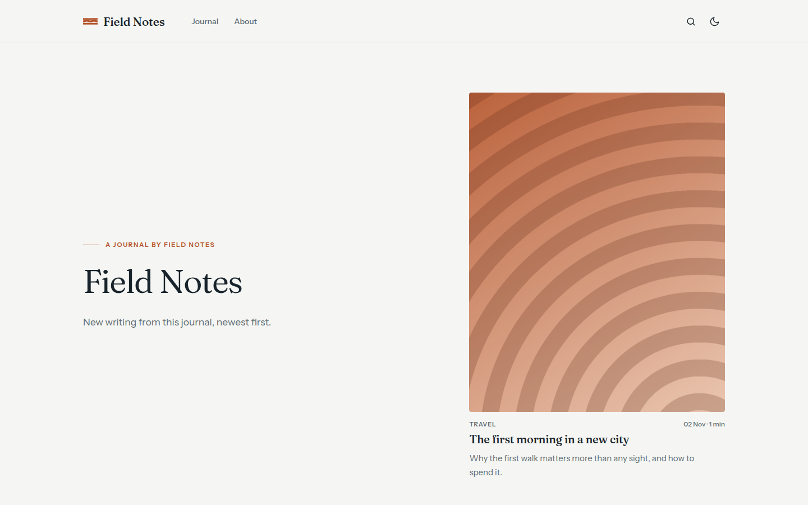

# Nagi

A calm blog theme: light serif headlines, a featured cover, numbered topics, a picture mosaic and a ledger of posts with large dates. Light and dark.

Nagi is the calm sea after the wind drops. Quiet, editorial, still.



A theme for [Hatamoto](https://hatamoto.dev), built for blog sites.

## Install

From the registry: **Theme > Themes > Available themes**, then **Install**, **Preview**
and **Activate**. From a terminal on the server:

```sh
hatamoto package install nagi-<version>.hmp
hatamoto theme activate nagi
```

Layouts and sections the theme does not ship come from the built-in theme, so every
page keeps rendering.

## What it ships

- Home, single post, plain page, archive, category and tag, author, search and 404 layouts.
- A header with the menu, search, a colour toggle and a Subscribe link; a menu that works without JavaScript on small screens.
- A deep footer band with a closing sentence, your footer menu, social links and feeds.
- Light and dark, with the same still-water mark in the logo, under the hero and in the footer.
- Home blocks that fill themselves from your posts and hide when there is nothing to show: no posts, no images, no categories and no menu all render cleanly.

## Settings

**Theme > Themes > Nagi > Settings**. Every setting has a default, an empty text means "use the fallback".

| Setting | Default | What it does |
| --- | --- | --- |
| Hero label (`hero_kicker`) | empty | The small line above the headline. Empty shows "A journal by" and the newest post's author, or the site name. |
| Hero headline (`hero_title`) | empty | The big headline. Empty uses the site tagline, then the site name. |
| Hero headline, italic half (`hero_title_italic`) | empty | A second half shown after the headline in a muted italic. |
| Hero text (`hero_lede`) | empty | The paragraph under the headline. Empty uses the site tagline. |
| Signup form (`signup_form`) | empty | Slug of a form for the email signup. Empty hides the signup and every Subscribe link. See below. |
| Show the featured post (`show_featured`) | on | The newest post with an image, next to the headline. |
| Show the topic index (`show_topics`) | on | The four categories with the most posts, with count, newest date and a line from the newest post. |
| Show the picture mosaic (`show_mosaic`) | on | Up to five more posts with images; needs at least three. |
| Show Further reading (`show_most_read`) | on | A sidebar list of the posts after the latest ones. It is not based on views. |
| Footer sentence (`footer_line`) | empty | The sentence in the footer band. Empty uses the site tagline; no tagline means no sentence. |
| Footer sentence, italic half (`footer_line_italic`) | empty | Shown after the sentence in a muted italic. |
| Show the homepage's own sections (`home_sections`) | off | Renders the sections of the page set as the homepage (for example ones built in the Page Builder) between the headline and the topic index. Off keeps the automatic journal only. |
| Address of the post archive (`archive_url`) | `/blog` | Where "More writing" and "All posts" lead. Set it to the archive address of your posts. |
| Colour mode (`color_mode`) | `light` | What a first visit shows: `light`, `dark` or `auto` (follows the system). Visitors can still switch with the header toggle. |

Colours, fonts and corners follow **Theme > Colours and fonts**; the accent colour is your primary colour. In dark mode the accent is lightened for text so it stays readable.

### Signup form

1. Create a form (Forms) with a field named `email`. Other fields are not shown by the theme.
2. Do not turn on a captcha: the theme prints its own small form and has no place for a captcha widget, so a form with a captcha will always answer with an error.
3. Put the form's slug in `signup_form`.

The hero then shows an underline email field. It works without JavaScript: the visitor is sent back to the page with a short thank-you (or error) line, and every submission lands in the form's inbox. The Subscribe link in the header and footer jumps to it from any page. If your site already has a call-to-action button in the header, that button is used instead.

## Fonts

[Fraunces](https://github.com/undercasetype/Fraunces) and [Instrument Sans](https://github.com/Instrument/instrument-sans) are bundled in `assets/fonts/` under the SIL Open Font License 1.1 (licence files next to the fonts). Nothing loads from another host.

## Develop

From the root of the `hatamoto-themes` repository:

```sh
scripts/dev-site.sh blog themes/nagi --serve   # a seeded local site with this theme, live reload
scripts/check.sh themes/nagi --screenshot      # the full check; also writes assets/screenshot.png
```

`dev/` is not part of the package.

## License

Apache-2.0, see [LICENSE](LICENSE). The fonts keep their own licence (OFL-1.1).
