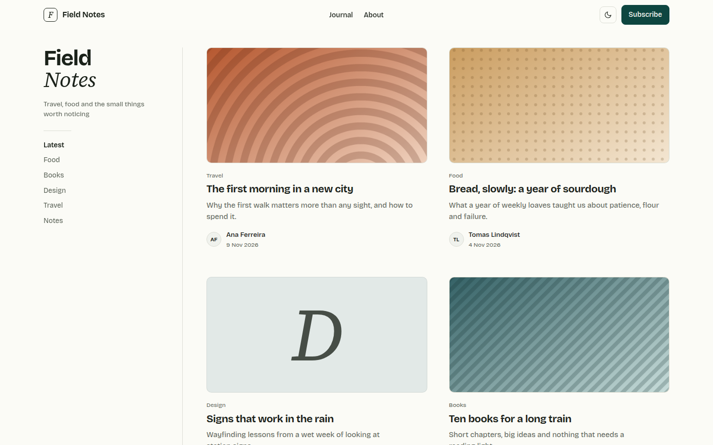

# Shinrin-yoku

Blog theme in forest green on cream: a split serif masthead, a sticky category sidebar and a two-column card grid on soft tinted panels, lime accents after dark.



A theme for [Hatamoto](https://hatamoto.dev), built for blog sites.

## Install

From the registry: **Theme > Themes > Available themes**, then **Install**, **Preview**
and **Activate**. From a terminal on the server:

```sh
hatamoto package install shinrin-yoku-<version>.hmp
hatamoto theme activate shinrin-yoku
```

Layouts and sections the theme does not ship come from the built-in theme, so every
page keeps rendering.

## What it ships

- Home, post archive, category and tag, author, single post, search and 404 layouts, plus the header, footer and mobile menu. Plain pages use the built-in sections, restyled to match.
- A sticky blurred top bar with a monogram, centred menu, colour toggle and one solid button; the menu folds into a no-JavaScript `<details>` on small screens.
- **Split masthead**: the site name in bold sans, its last word on its own line in italic serif, over the tagline and a short hairline.
- **Sticky category sidebar** with a full-height hairline beside the card grid; below 860 px it becomes a row of scrolling chips.
- **Tinted cards**: a soft tint per category behind each post (five tints, cycling). A featured image fills the panel; a post without one shows the category's initial in large italic serif.
- A single post with a 44 rem reading column, serif italic quotes, a framed cover and two more posts at the end.
- Numbered pagination, a footer with a closing quote and link columns, light and dark. No JavaScript is needed for anything except the colour toggle.

## Settings

**Theme > Themes > Shinrin-yoku > Settings**. Every setting has a default.

| Setting | Type | Default | What it does |
| --- | --- | --- | --- |
| Colour mode (`color_mode`) | `light`, `dark`, `auto` | `auto` | What a first visit shows; `auto` follows the system. Visitors can still switch with the header toggle. |
| Spacing (`density`) | `comfortable`, `compact` | `comfortable` | `compact` tightens the space between sections and cards. |
| Split masthead (`split_masthead`) | on/off | on | Last word of the site name on its own line in italic serif. |
| Tinted cards (`card_tints`) | on/off | on | A soft tint per category behind each card; off gives one neutral panel. |
| Show author (`show_author`) | on/off | on | The author line on cards and posts. |
| Button label (`cta_label`) | text | `Subscribe` | The header button. The site's own header button wins. |
| Button address (`cta_url`) | text | `/feed.xml` | Where the button goes; empty hides it. |
| Footer quote (`footer_quote`) | text | empty | The italic line in the footer; empty uses the site tagline. |
| Home page sections (`home_sections`) | on/off | off | Prints the blocks of the home page built in the editor below the post grid. |
| Address of the post archive (`archive_url`) | text | `/blog` | Where "Latest" points. |

Colours, fonts and corners follow **Theme > Colours and fonts**. The stock forest primary turns lime in dark mode; any other primary you pick is lightened for dark.

## Fonts

Self-hosted, no request to another host, both under the SIL Open Font License 1.1 (licence files sit next to the fonts):

- [Bricolage Grotesque](https://fonts.google.com/specimen/Bricolage+Grotesque) for headings, interface and body.
- [Source Serif 4](https://fonts.google.com/specimen/Source+Serif+4), normal and italic, for the masthead word, quotes and initials.

## Develop

From the root of the `hatamoto-themes` repository:

```sh
scripts/dev-site.sh blog themes/shinrin-yoku --serve   # a seeded local site with this theme, live reload
scripts/check.sh themes/shinrin-yoku --screenshot               # the full check: package, render, browser, screenshot
```

`dev/` is not part of the package.

## License

Apache-2.0, see [LICENSE](LICENSE).
