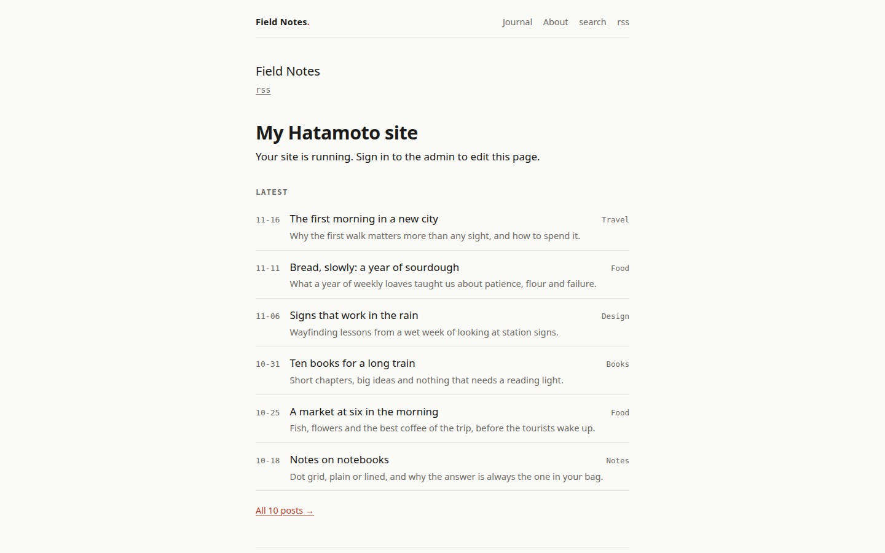

# Sumi

A text-first blog theme for [Hatamoto](https://hatamoto.dev). System fonts, monospace
dates, hairline rows and one vermilion accent.



**The size claim.** The theme adds no stylesheet, script, font or request of its own,
and each page it renders stays under 13.37 KB gzipped (13,370 bytes) on the blog seed.
Anything the Hatamoto core or the owner adds (the analytics beacon, a consent banner,
fonts, tags) is not counted by this claim.

- **Home** with the site tagline, the latest posts as dated rows and a link to the archive.
- **Posts** with a featured image, headings, lists, quotes, tables, code, an older link
  and more posts from the same category.
- **Archive, category, author and search pages** as hairline rows, the archive grouped by
  year. Search is a plain form, with the match marked in titles and excerpts.
- **404** with a search box and the latest posts.
- **Pages and Page Builder sections** in plain typography, with the built-in contact form
  styled to match (see Limits).
- **Newsletter block** (optional): an email field posting to a Hatamoto form, in the
  footer or around the homepage post list. Off until a form is named in the settings.
- **Light by default**, dark or following the system through a setting. There is no
  visitor toggle: it would need JavaScript.

All CSS is inline in each page, so there is no stylesheet to fetch. Everything works
without JavaScript, and the theme runs under the strict public script policy
(`csp.strictScripts`).

## Install

From the registry: **Theme > Themes > Available themes**, then **Install**, **Preview**
and **Activate**. From a terminal on the server:

```sh
hatamoto package install sumi-<version>.hmp
hatamoto theme activate sumi
```

Layouts and sections the theme does not ship come from the built-in theme, so every
page keeps rendering.

## Settings

**Theme > Themes > Sumi > Settings**:

| Key | Type | Default | What it does |
| --- | --- | --- | --- |
| `color_mode` | `light`, `dark`, `auto` | `light` | the colour scheme; `auto` follows the visitor's system |
| `density` | `comfortable`, `compact` | `comfortable` | `compact` tightens rows and sections |
| `show_theme_line` | boolean | `true` | the footer line about the theme's size and requests |
| `show_home_byline` | boolean | `true` | the "by author · rss" line under the tagline on the home page |
| `home_list` | `summaries`, `titles` | `summaries` | `titles` lists the home posts as titles only, without the summary line |
| `home_title` | `auto`, `tagline`, `hidden` | `auto` | `auto`: tagline, or the site name when there is none. `tagline`: only when a tagline is set. `hidden`: no visible heading (a visually hidden `h1` with the site name is added, unless the page has a hero or its own `h1`) |
| `show_credit` | boolean | `true` | the credit after the copyright in the footer |
| `credit_text` | string | `Powered by Hatamoto CMS` | the words after the copyright |
| `credit_url` | string | `https://hatamoto.dev` | where the credit links |
| `posts_on_home` | integer 3 to 20 | `6` | how many posts the home page lists |
| `newsletter_form` | string | empty | slug of the form the subscribe block posts to; empty shows no block |
| `newsletter_position` | `footer`, `above_posts`, `below_posts` | `footer` | `footer`: top of the footer on every page. `above_posts` / `below_posts`: before or after the post list on the home page (other pages keep the footer) |
| `newsletter_text` | string | `Get new posts by email. No more than one a week.` | the sentence above the field; empty removes it (the field keeps a hidden label) |
| `newsletter_button` | string | `subscribe` | the button label |
| `newsletter_placeholder` | string | `you@example.com` | the hint inside the email field |

## Colours

**Theme > Colours and fonts** restyles the theme. The primary colour drives the accent
(links, the dot after the site name, quote rules); the default is a vermilion. In dark
mode the accent is derived from it, lightened so it stays readable on the dark page.

## Limits

- **Forms with a captcha.** The theme loads no JavaScript, and the captcha widget comes
  from the built-in script, so a contact form with a captcha switched on cannot submit.
  Use a form without a captcha with this theme.
- **Newsletter block.** The form named in `newsletter_form` must exist and be active; the
  theme cannot check it, and a wrong slug shows a form that fails on submit. The block
  sends only an `email` field, so `email` must be the form's only required field: with
  the Newsletter signup template, untick "consent" (or remove it). The thank-you and error
  notice is fixed text, shown for the whole page, so it also appears next to a contact
  form on the same page. `above_posts` and `below_posts` apply to the homepage only.

## Develop

From the root of the `hatamoto-themes` repository:

```sh
scripts/dev-site.sh blog themes/sumi --serve    # a seeded local site with this theme, live reload
scripts/check.sh themes/sumi --screenshot       # the full check, and the registry screenshot
themes/sumi/dev/budget.sh                       # bytes per blog seed page, fails over 13,370
```

`budget.sh` runs on the core this repository pins, which predates the speculation rules
and the analytics tag; it adds their size as a constant. Set `HATAMOTO_BIN` to a build of
a newer core to measure the real thing.

`dev/` is not part of the package.

## License

Apache-2.0, see [LICENSE](LICENSE).
