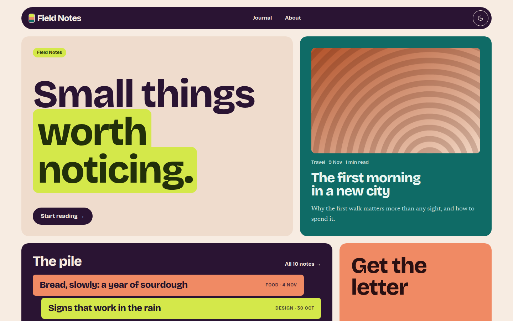

# Tsundoku

Warm, playful blog theme: clay paper, plum ink and chartreuse, a rounded bento home and recent posts stacked as coloured book spines.



A theme for [Hatamoto](https://hatamoto.dev), built for blog sites.

## Install

From the registry: **Theme > Themes > Available themes**, then **Install**, **Preview**
and **Activate**. From a terminal on the server:

```sh
hatamoto package install tsundoku-<version>.hmp
hatamoto theme activate tsundoku
```

Layouts and sections the theme does not ship come from the built-in theme, so every
page keeps rendering.

## What it ships

- Home, single post, plain page, archive, category and tag, author, search and 404 layouts.
- A floating pill header with the menu, a colour toggle and your header button; on small screens the menu opens as a chartreuse sheet and works without JavaScript.
- A bento home: a hello tile with a highlighted headline, the newest post, **the pile** (recent posts stacked as coloured book spines), a newsletter tile, your categories as chips and three more posts as cards.
- A single post with a colour-card header, contents chips, a chartreuse pull quote and previous/next tiles.
- Light and dark. No JavaScript is needed for anything except the colour toggle.

## Settings

**Theme > Themes > Tsundoku > Settings**. Every setting has a default.

| Setting | Type | Default | What it does |
| --- | --- | --- | --- |
| Colour mode (`color_mode`) | `light`, `dark`, `auto` | `auto` | What a first visit shows; `auto` follows the system. Visitors can still switch with the header toggle. |
| Spacing (`density`) | `comfortable`, `compact` | `comfortable` | `compact` tightens the space between sections. |
| Home headline (`home_headline`) | text | `Small things\|worth noticing.` | The big line on the home page. Text after a `\|` is highlighted in chartreuse. |
| Recent posts (`recent_style`) | `pile`, `list` | `pile` | `pile` shows coloured spines; `list` shows plain rows on the plum tile. |
| Show the newsletter tile (`show_newsletter`) | on/off | on | The tile links to the site's header button when there is one, else to `/feed.xml`. Off lets the pile take the full row. |
| Archive path (`archive_path`) | text | empty | Where the "Start reading" and "Browse the journal" links go, e.g. `/blog`. Empty works it out from the newest post's address, and hides the links when that gives no path. |
| Corners (`corners`) | `rounded`, `soft`, `square` | `rounded` | The corner radius of tiles and cards. Pills and buttons stay round. |

## Colours and fonts

**Theme > Colours and fonts** restyles the colours and fonts. Your colours drive light
mode; in dark mode the paper, tones and chartreuse are the theme's own, set for contrast,
and the primary colour is derived from yours. The spine colours are fixed.

[Bricolage Grotesque](https://fonts.google.com/specimen/Bricolage+Grotesque) (headings) and
[Newsreader](https://fonts.google.com/specimen/Newsreader) (text), both under the SIL Open Font
License 1.1, are self-hosted (licences in `assets/fonts/`). Nothing loads from another host.

## Develop

From the root of the `hatamoto-themes` repository:

```sh
scripts/dev-site.sh blog themes/tsundoku --serve   # a seeded local site with this theme, live reload
scripts/check.sh themes/tsundoku --screenshot               # the full check, and the registry screenshot
```

`dev/` is not part of the package.

## License

Apache-2.0, see [LICENSE](LICENSE).
