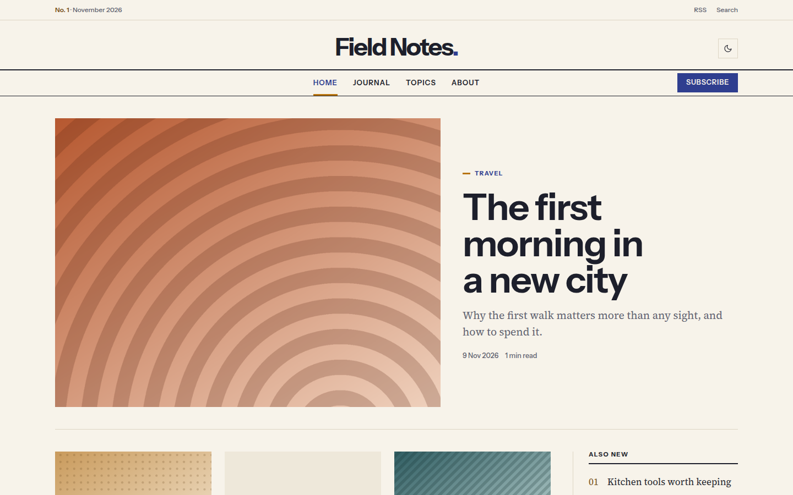

# Ukiyou

A dense magazine blog theme in indigo and saffron: a centred wordmark, a lead story beside a three-column grid with a numbered sidebar, bold sans headlines over serif text.

Ukiyou reads like a printed issue: ruled navigation, an issue line above the masthead, flat colour and square corners. Light and dark, three accent presets, no JavaScript needed except the colour toggle.



A theme for [Hatamoto](https://hatamoto.dev), built for blog sites.

## Install

From the registry: **Theme > Themes > Available themes**, then **Install**, **Preview**
and **Activate**. From a terminal on the server:

```sh
hatamoto package install ukiyou-<version>.hmp
hatamoto theme activate ukiyou
```

Layouts and sections the theme does not ship come from the built-in theme, so every
page keeps rendering.

## What it ships

- Home, single post, archive, category and tag, author, search and 404 layouts.
- An issue line, a centred wordmark, a ruled menu and an optional Subscribe button; on small screens the menu is a native disclosure that works without JavaScript.
- A lead story, a grid of the next six, a numbered "Also new" list with topic chips, and a subscribe band, all filled from your content and hidden when there is nothing to show.
- A single post with a story index, pull quotes, author box, previous and next links and related stories.
- Light and dark, with text contrast of at least 4.5:1 for every accent.
- If your home page has builder sections, Ukiyou renders them instead of the magazine front page; clear the home page's sections to get the magazine front page.

## Settings

**Theme > Themes > Ukiyou > Settings**. Every setting has a default.

| Setting | Type | Default | What it does |
| --- | --- | --- | --- |
| Colour mode (`color_mode`) | `light`, `dark`, `auto` | `auto` | What a first visit shows; `auto` follows the system. Visitors can still switch with the header toggle. |
| Spacing (`density`) | `comfortable`, `compact` | `comfortable` | `compact` tightens the vertical space between blocks. |
| Issue strip (`issue_strip`) | on/off | on | Shows the issue line above the wordmark; off moves Search into the menu bar. |
| Issue label (`issue_label`) | text | `No. 1` | Printed in the issue strip, followed by the month and year of the newest post. |
| Home sidebar (`sidebar`) | on/off | on | The numbered list and topic chips next to the home grid; off gives a four-column grid. |
| Sidebar title (`sidebar_title`) | text | `Also new` | Heading of the numbered list. |
| Subscribe link (`subscribe_url`) | URL | empty | Where the Subscribe button and band lead. Both stay hidden while this is empty. |
| Subscribe headline (`subscribe_headline`) | text | `New stories, twice a month. Nothing else.` | Headline of the subscribe band on the home page. |
| Accent (`accent`) | `saffron`, `brick`, `teal` | `saffron` | The colour of rules, bars, numerals and the Subscribe button. |

## Colours and fonts

**Theme > Colours and fonts** restyles the primary colour (indigo by default), background, text,
fonts and corners. The paper, panel, rule and muted tones, and the accent presets, are the
theme's own, set for contrast on the default palette.

## Fonts

[Instrument Sans](https://github.com/Instrument/instrument-sans) (headlines and labels) and
[Source Serif 4](https://github.com/adobe-fonts/source-serif) (text), both under the SIL Open
Font License 1.1, self-hosted in `assets/fonts/` with their licence files.

## Develop

From the root of the `hatamoto-themes` repository:

```sh
scripts/dev-site.sh blog themes/ukiyou --serve                # a seeded local site with this theme, live reload
scripts/check.sh themes/ukiyou --screenshot                   # the full check: package, render, browser, screenshot
```

`dev/` is not part of the package.

## License

Apache-2.0, see [LICENSE](LICENSE). The fonts keep their own licences.
