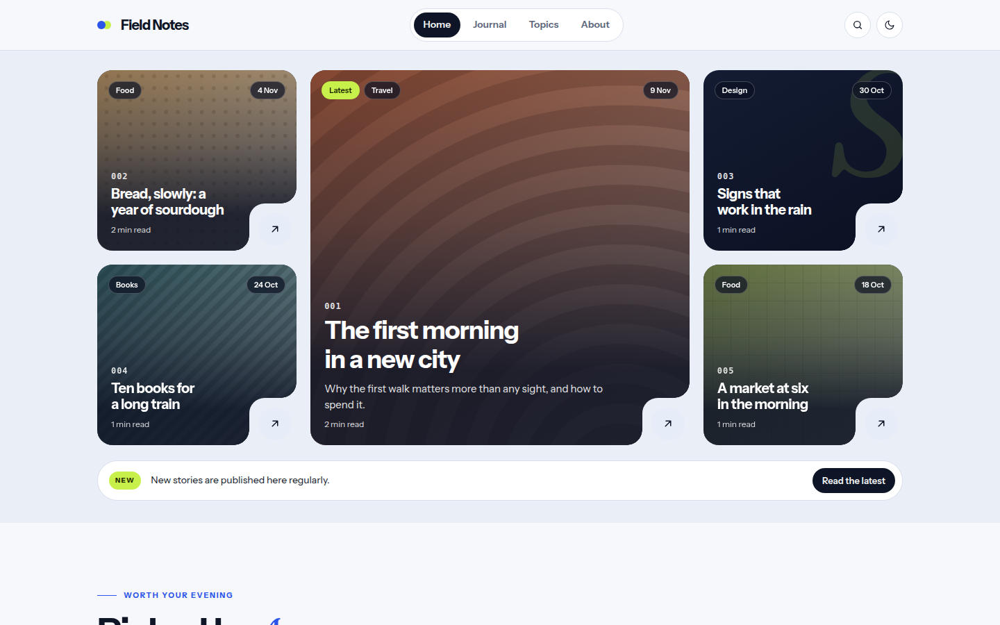

# Wa

Bold magazine blog theme: a mosaic hero of notched image cards, numbered picks, topic chips and a night band, in cobalt and lime on cool paper.

"Wa" is the Japanese word for a ring and for harmony. Rounded cards with one square notch, one strong colour, one sharp accent. Light and dark.



A theme for [Hatamoto](https://hatamoto.dev), built for blog sites.

## Install

From the registry: **Theme > Themes > Available themes**, then **Install**, **Preview**
and **Activate**. From a terminal on the server:

```sh
hatamoto package install wa-<version>.hmp
hatamoto theme activate wa
```

Layouts and sections the theme does not ship come from the built-in theme, so every
page keeps rendering.

## What it ships

- Home, single post, plain page, archive, category and tag, author, search and 404 layouts.
- A header with a pill menu, search, a colour toggle and a button; a menu that works without JavaScript on small screens.
- A home page filled from your posts and topics: a mosaic hero of the latest five, an announcement pill, numbered picks, a ticker, topic chips, a dark band with an archive grid and a newsletter call to action, and a reading queue. Every block hides itself when there is nothing to show.
- Posts with a contents list, a drop cap, share buttons, a byline and author box, previous and next links and more from the same topic.
- Cards without a featured image get a typographic tile, drawn inline.
- Light and dark. No JavaScript is needed for anything except the colour toggle.

## Settings

**Theme > Themes > Wa > Settings**. Every setting has a default.

| Setting | Type | Default | What it does |
| --- | --- | --- | --- |
| Colour mode (`color_mode`) | `light`, `dark`, `auto` | `auto` | What a first visit shows; `auto` follows the system. Visitors can still switch with the header toggle. |
| Spacing (`density`) | `comfortable`, `compact` | `comfortable` | `compact` tightens the space between sections. |
| Show the ticker (`show_ticker`) | on/off | on | The strip of topics and recent titles under the picks. |
| Show topics (`show_topics`) | on/off | on | The topic chips section. |
| Show the archive band (`show_archive_band`) | on/off | on | The dark band with older stories (needs more than five posts). |
| Show the newsletter block (`show_newsletter`) | on/off | on | The call to action in the dark band. It links to a page and has no form. |
| Picks heading (`picks_heading`) | text | `Picked by` | Heading of the picks section. |
| Picks accent word (`picks_accent`) | text | empty | The italic word after it. Empty uses the first name of the featured post's author, or "us". |
| Archive heading, accent, end (`archive_heading`, `archive_accent`, `archive_tail`) | text | `Worth a`, `second`, `read` | The archive band heading. |
| Reading queue heading, accent, end (`queue_heading`, `queue_accent`, `queue_tail`) | text | `Don't`, `miss`, `these` | The last section's heading. |
| Announcement text (`announce_text`) | text | `New stories are published here regularly.` | The pill under the hero. Empty hides it. |
| Announcement button (`announce_label`) | text | `Read the latest` | The button in the pill; empty hides the button. |
| Announcement link (`announce_url`) | text | `/blog` | Where the button goes. |
| Newsletter heading, accent, end (`newsletter_heading`, `newsletter_accent`, `newsletter_tail`) | text | `Stay in`, `the loop`, empty | The newsletter heading. |
| Newsletter text (`newsletter_text`) | text | `Find out what is new, in one place.` | One line under the heading. |
| Newsletter button (`newsletter_button`) | text | `Subscribe` | The button label; also the header button when the site has no header button of its own. Empty hides both buttons. |
| Newsletter link (`newsletter_url`) | text | empty | Where that button goes, for example a page with your sign-up form. While it is empty, neither the newsletter button nor the header button is shown. |
| Signal colour (`signal_colour`) | hex colour | `#c8f04a` | The accent on chips, badges and the newsletter button. Text on it is a fixed dark ink, so choose a **light** colour; a dark value makes that text hard to read. It is a plain text field: type `#rgb` or `#rrggbb`, such as `#c8f04a`. |
| Journal link (`archive_url`) | text | `/blog` | Where the "All stories" links and the 404 button lead. |
| Home page (`home_layout`) | `auto`, `blocks`, `magazine` | `auto` | `auto` shows the blocks of the home page built in the editor when it has more than one block, or when the site has no posts, so a business or landing site keeps its own home; otherwise (exactly one block, as on a freshly booted site) it shows the generated magazine home. The setup wizard's starter home has three blocks, so it keeps them; choose `magazine` to show the generated home there. There is no reliable signal for an untouched starter home. `blocks` and `magazine` force one of them. |

Empty text settings fall back to their defaults, except the announcement text, the
announcement button, the newsletter heading end, the newsletter button and the newsletter link, which hide their part.

## Colours and fonts

**Theme > Colours and fonts** restyles the primary colour, background, text, fonts and
corners. The owner's colours drive light mode; in dark mode the primary is derived from
yours (lightened) and the paper and panel tones are the theme's own, so dark mode stays
readable. Choose a mid or dark primary: white text sits on it in light mode, and a very light
colour such as yellow will not reach a readable contrast there. The lime signal colour is
separate, see above.

## Fonts

[Instrument Sans](https://fonts.google.com/specimen/Instrument+Sans) (headings and text) and
[Fraunces](https://fonts.google.com/specimen/Fraunces) (italic accent words only), both under
the SIL Open Font License 1.1, self-hosted in `assets/fonts/` with their licences
(`LICENSE.txt` in each folder).

## Develop

From the root of the `hatamoto-themes` repository:

```sh
scripts/dev-site.sh blog themes/wa --serve   # a seeded local site with this theme, live reload
scripts/check.sh themes/wa --screenshot      # the full check, and the registry preview
```

`dev/` is not part of the package.

## License

Apache-2.0, see [LICENSE](LICENSE).
