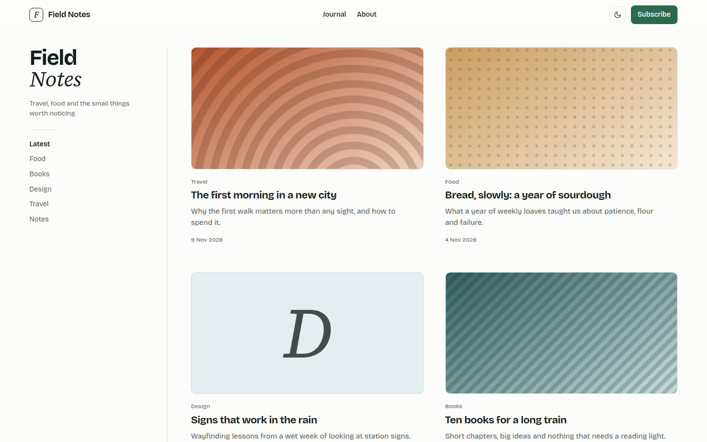

# Yukigeshiki

Editorial blog theme: a sticky masthead and category sidebar, a two-column card grid on tinted panels, Bricolage Grotesque with Source Serif italics, in pine green.



A theme for [Hatamoto](https://hatamoto.dev), built for blog sites.

## Install

From the registry: **Theme > Themes > Available themes**, then **Install**, **Preview**
and **Activate**. From a terminal on the server:

```sh
hatamoto package install yukigeshiki-<version>.hmp
hatamoto theme activate yukigeshiki
```

Layouts and sections the theme does not ship come from the built-in theme, so every
page keeps rendering.

## What it ships

- Home, single post, archive, category and tag, author, search and 404 layouts; plain pages use the built-in page layout, restyled to match.
- A sticky, blurred top bar with a monogram, the menu, a colour toggle and a button; a menu that works without JavaScript on small screens.
- A sticky sidebar with the site name (the last word on its own line, in italic serif), the tagline and the category list; on small screens the list becomes a row of chips.
- A two-column card grid on soft panels: a tint per category, the featured image over it, or the category initial in italic serif when a post has no image.
- Numbered pagination, a reading column for posts with serif italic quotes, and "More posts" under each article.
- A footer with your quote, link columns and a legal row.
- Light and dark. No JavaScript is needed for anything except the colour toggle.

## Settings

**Theme > Themes > Yukigeshiki > Settings**. Every setting has a default.

| Setting | Type | Default | What it does |
| --- | --- | --- | --- |
| Colour mode (`color_mode`) | `light`, `dark`, `auto` | `auto` | What a first visit shows; `auto` follows the system. Visitors can still switch with the header toggle. |
| Spacing (`density`) | `comfortable`, `compact` | `comfortable` | `compact` tightens the space between sections. |
| Split masthead (`split_masthead`) | on/off | on | The last word of the site name on its own line, in italic serif. |
| Tinted cards (`card_tints`) | on/off | on | A soft tint per category behind each card. Off gives one neutral panel. |
| Show author (`show_author`) | on/off | on | The author line on cards and posts, when the post has an author. |
| Button label (`cta_label`) | text | `Subscribe` | The header button. The site's own header button (Site settings) wins when set. |
| Button address (`cta_url`) | URL | `/feed.xml` | Where the button leads; empty hides it. |
| Footer quote (`footer_quote`) | text | empty | The italic line under the footer logo. Empty uses the site tagline. |
| Address of the post archive (`archive_url`) | URL | `/blog` | Where the "Latest" links lead. |

## Colours and fonts

**Theme > Colours and fonts** restyles the primary colour, background, text, fonts and
corners. The surface, tint, rule and muted tones are the theme's own, set for contrast on
the default palette; in dark mode the primary colour is lightened to stay readable.

## Fonts

[Bricolage Grotesque](https://fonts.google.com/specimen/Bricolage+Grotesque) (headings and
text) and [Source Serif 4](https://fonts.google.com/specimen/Source+Serif+4) (italic accents),
both under the SIL Open Font License 1.1, bundled in `assets/fonts/` with their licences.

## Develop

From the root of the `hatamoto-themes` repository:

```sh
scripts/dev-site.sh blog themes/yukigeshiki --serve   # a seeded local site with this theme, live reload
scripts/check.sh themes/yukigeshiki --screenshot   # the full check, and the registry preview
```

`dev/` is not part of the package.

## License

Apache-2.0, see [LICENSE](LICENSE).
